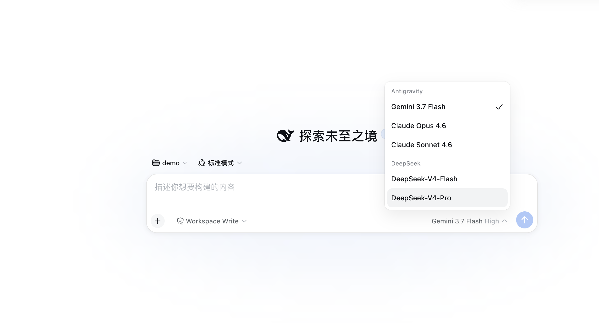
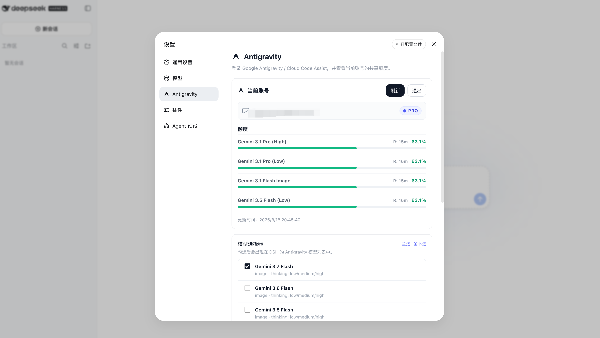

# dsh-antigravity

<p align="center">
  
</p>

English | [简体中文](./README.zh.md)

Google Antigravity / Cloud Code Assist model provider for [DeepSeek Harness](https://github.com/deepseek-ai/deepseek-harness).

Based on [LiZhenNet/dsh-antigravity](https://github.com/LiZhenNet/dsh-antigravity), with a multi-account pool added: you can sign in with several Google accounts and requests are scheduled across them. See [QUOTA-SCHEDULING.md](./QUOTA-SCHEDULING.md) for how scheduling works.

> Unofficial integration. This project is not affiliated with or endorsed by Google. Use it only with accounts and services you are authorized to access.

---

## Installation

### Method 1: Install from GitHub (Recommended)

```sh
dsh plugin --profile web add github:almost-nowhere/dsh-antigravity
```

### Method 2: Local Release Package

```sh
npm run pack:dist
dsh plugin --profile web add ./dist/dsh-antigravity-0.0.9.tgz
```

Or add to your profile's `cordis.patch.yml`:

```yaml
- insert:
    - id: llm-antigravity
      name: dsh-antigravity
```

---

## Login & Authentication

Open **Settings > Antigravity** and click **Login** to authorize via Google OAuth. The settings page automatically refreshes your quota upon login. You can add multiple accounts in the settings view to configure a pool.



The plugin starts a loopback OAuth callback server at `http://localhost:51121/oauth-callback`. If your browser does not open automatically, run the CLI helper:

```sh
node "$DSH_HOME/profiles/web/node_modules/dsh-antigravity/bin/antigravity-login.mjs"
```

Credentials are saved at: `$DSH_HOME/storages/antigravity-oauth.json`.

---

## Models

Select **Antigravity** in the DSH model picker. You can configure individual models in **Settings > Antigravity**.

| Model ID | Name | Quota pool |
|---|---|---|
| `gemini-3.8-flash` | Gemini 3.8 Flash | Gemini |
| `gemini-3.7-flash` | Gemini 3.7 Flash | Gemini |
| `gemini-3.6-flash` | Gemini 3.6 Flash | Gemini |
| `gemini-3.5-flash` | Gemini 3.5 Flash | Gemini |
| `gemini-3.1-pro` | Gemini 3.1 Pro | Gemini |
| `gemini-3.1-flash-image` | Gemini 3.1 Flash Image | Gemini |
| `gemini-3-flash` | Gemini 3 Flash | Gemini |
| `gemini-2.5-pro` | Gemini 2.5 Pro | Gemini |
| `gemini-2.5-flash` | Gemini 2.5 Flash | Gemini |
| `claude-opus-4-6` | Claude Opus 4.6 | Claude & GPT (3P) |
| `claude-sonnet-4-6` | Claude Sonnet 4.6 | Claude & GPT (3P) |
| `gpt-oss-120b` | GPT-OSS 120B | Claude & GPT (3P) |

Reasoning-capable models map thinking tokens into DSH's native `reasoning` blocks, with configurable effort tiers.

---

## License

[MIT](./LICENSE)
