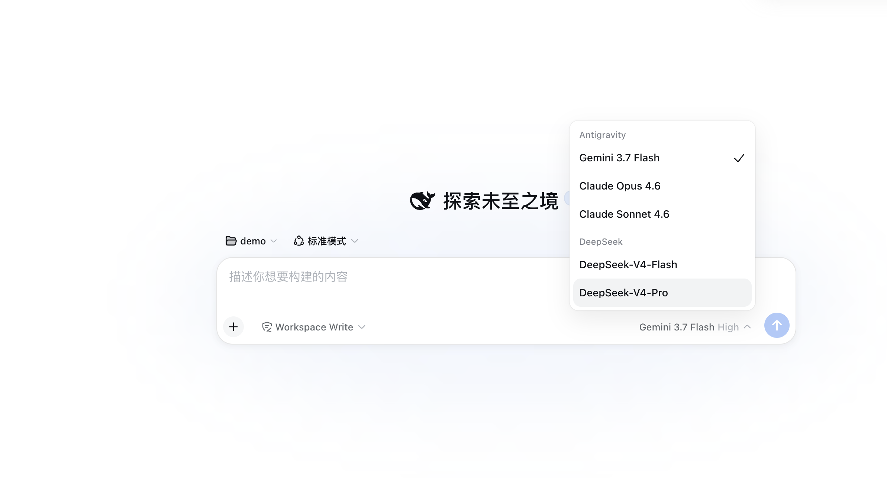
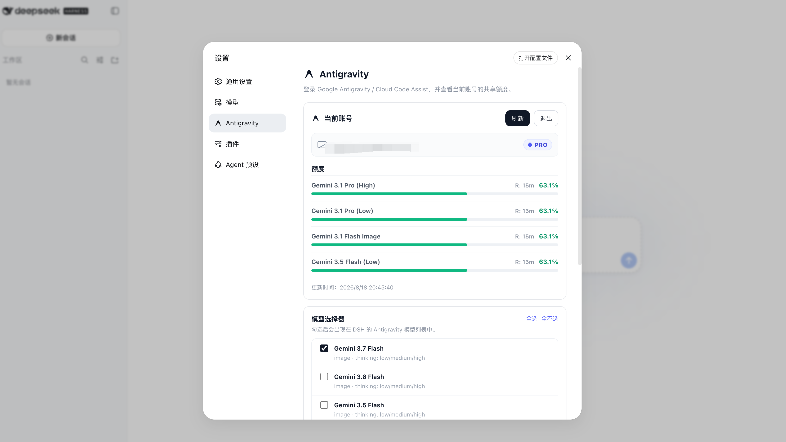

# dsh-antigravity

<p align="center">
  
</p>

[English](./README.md) | 简体中文

适用于 [DeepSeek Harness](https://github.com/deepseek-ai/deepseek-harness) 的 Google Antigravity / Cloud Code Assist 模型提供商插件。

支持 Google 账号 OAuth 登录、**多账号智能号池调度**、实时配额监控、故障转移降级与会话亲和管理，并完整支持中英文双语界面。

> **致谢与来源**：本项目基于 [LiZhenNet/dsh-antigravity](https://github.com/LiZhenNet/dsh-antigravity) 进行扩展开发。感谢原作者为社区带来的基础集成工作！在此基础上，本项目增加了多账号池调度、健康感知、故障转移和诊断支持。

---

## 核心特性

- **多账号号池调度**：支持添加多个 Google 账号，根据各账号实时额度与在途请求平滑分配。同会话优先保持账号亲和，额度告警或触发限流时自动平滑故障转移。
- **实时配额监控**：直观展示 Gemini 与 3P（Claude / GPT）分组的 5 小时与每周配额进度条、重置时间及号池综合指数。
- **全系模型支持**：支持最新的 `gemini-3.8-flash`、`gemini-3.7-flash`、`claude-opus-4-6`、`claude-sonnet-4-6` 等，支持高/中/低思考档位与 thoughts 映射。
- **请求失败诊断**：请求异常时自动生成本地诊断日志，方便排查定位。

---

## 安装到 DSH Web

### 方式一：直接从 GitHub 安装（推荐）

```sh
dsh plugin --profile web add github:almost-nowhere/dsh-antigravity
```

### 方式二：通过本地 Release 包安装

```sh
npm run pack:dist
dsh plugin --profile web add ./dist/dsh-antigravity-0.0.9.tgz
```

或手动添加至 profile 的 `cordis.patch.yml`：

```yaml
- insert:
    - id: llm-antigravity
      name: dsh-antigravity
```

---

## 登录与授权

打开 **设置（Settings）> Antigravity** 并点击 **登录（Login）**，通过 Google OAuth 授权绑定账号。绑定后将自动刷新配额。支持在设置页面添加多个账号组成调度号池。



插件在本地启动 loopback OAuth 回调服务（`http://localhost:51121/oauth-callback`）。若浏览器未自动唤起，可运行终端登录助手：

```sh
node "$DSH_HOME/profiles/web/node_modules/dsh-antigravity/bin/antigravity-login.mjs"
```

凭证存储路径：`$DSH_HOME/storages/antigravity-oauth.json`。

---

## 模型列表

在 DSH 模型选择器中选择 **Antigravity** 提供商。可在 **设置 > Antigravity** 中按需启用或关闭特定模型。

| 模型 ID | 名称 | 额度池 |
|---|---|---|
| `gemini-3.8-flash` | Gemini 3.8 Flash | Gemini |
| `gemini-3.7-flash` | Gemini 3.7 Flash | Gemini |
| `gemini-3.6-flash` | Gemini 3.6 Flash | Gemini |
| `gemini-3.5-flash` | Gemini 3.5 Flash | Gemini |
| `gemini-3.1-pro` | Gemini 3.1 Pro | Gemini |
| `gemini-3.1-flash-image` | Gemini 3.1 Flash Image | Gemini |
| `gemini-3-flash` | Gemini 3 Flash | Gemini |
| `gemini-2.5-pro` | Gemini 2.5 Pro | Gemini |
| `gemini-2.5-flash` | Gemini 2.5 Flash | Gemini |
| `claude-opus-4-6` | Claude Opus 4.6 | Claude & GPT (3P) |
| `claude-sonnet-4-6` | Claude Sonnet 4.6 | Claude & GPT (3P) |
| `gpt-oss-120b` | GPT-OSS 120B | Claude & GPT (3P) |

支持推理的模型默认采用适度思考强度，流式输出自动映射为 DSH `reasoning` 内容块，可在模型选择器中自由调节思考档位。

---

## 许可证

[MIT](./LICENSE)
